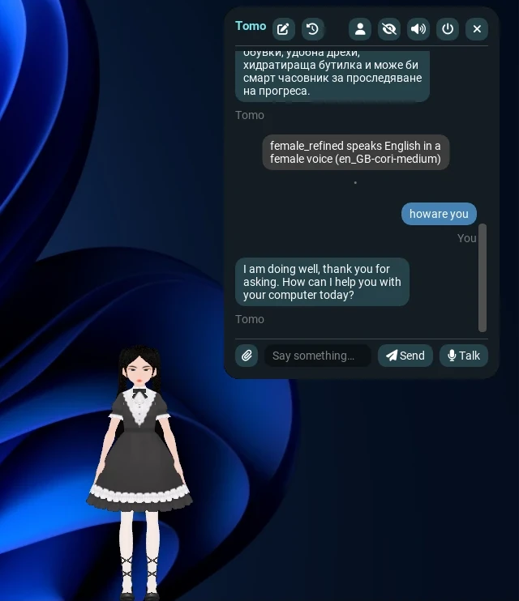
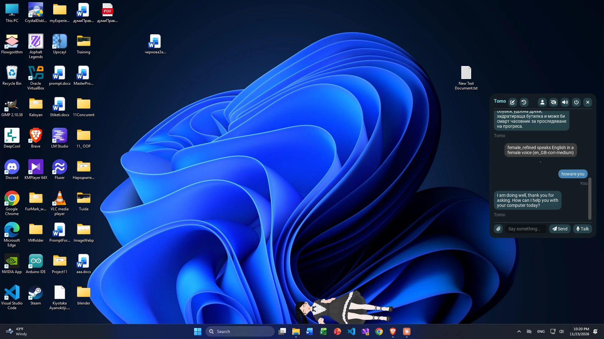
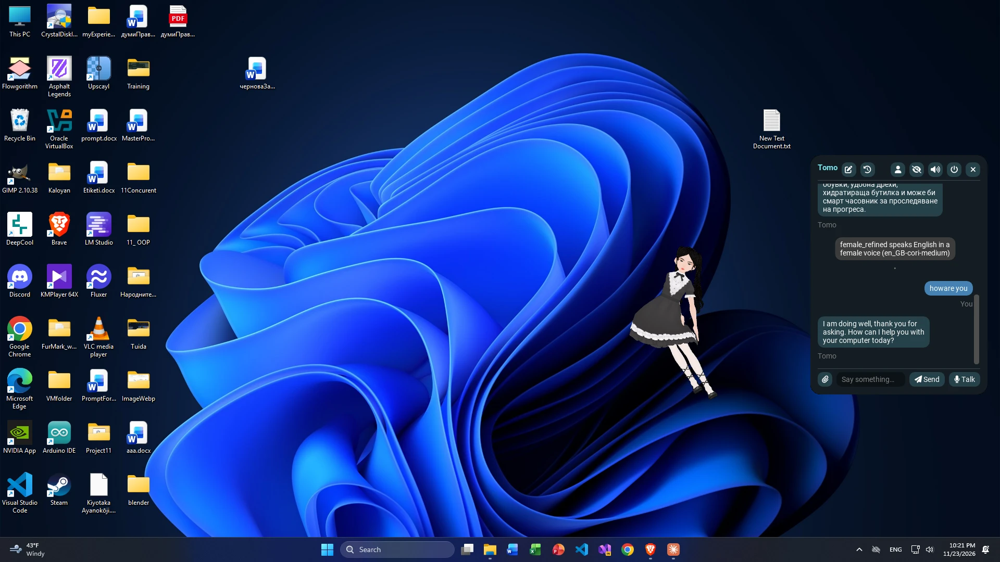
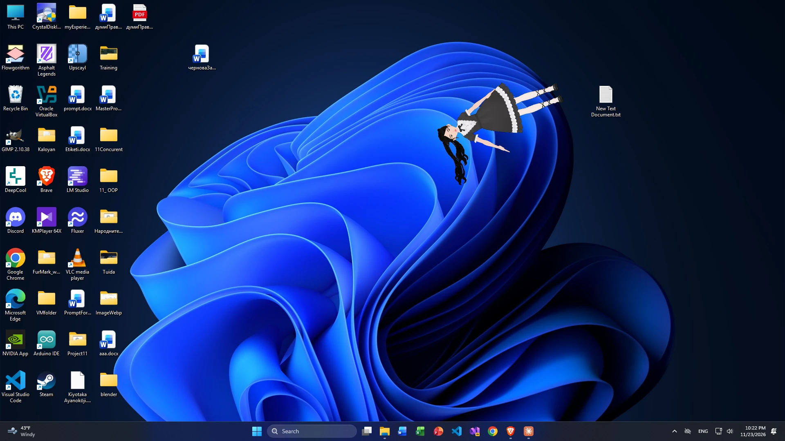
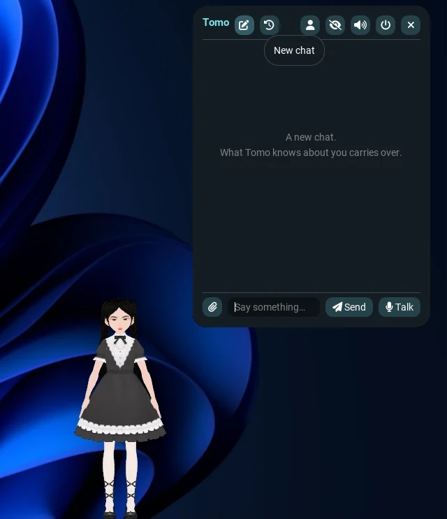
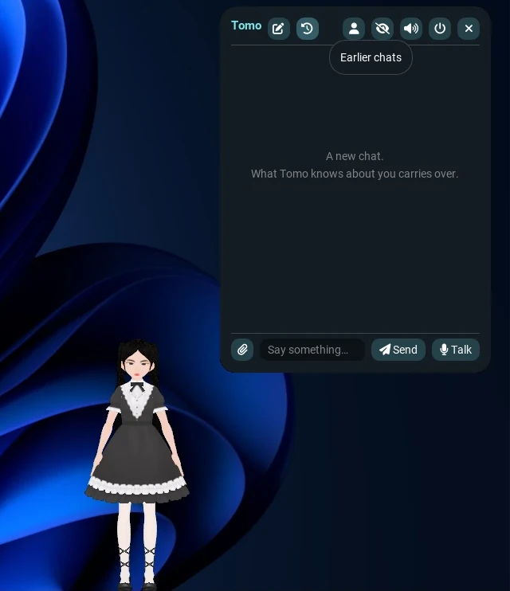
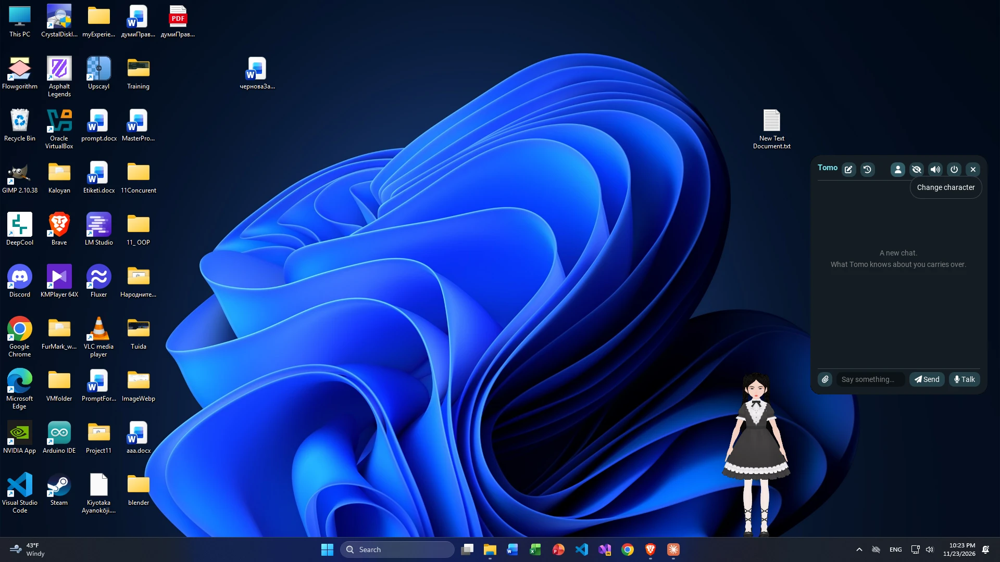

# Tomo — вашият ежедневен помощник

Tomo е настолно приложение за Windows и Linux — асистент, който улеснява
ежедневната работа с компютъра. На работния плот живее 3D анимиран персонаж
(създаден с VRoid Studio), с когото потребителят разговаря с текст или с глас,
на български или на английски. Tomo отговаря на въпроси, отваря и затваря
приложения, сменя настройки като силата на звука и създава файлове, а
наученото за потребителя помни и в следващите разговори. Няма възрастови
ограничения: всеки може да го ползва по свой начин, без регистрация. Всичко
работи на самия компютър, без облачни услуги, така че разговорите не го
напускат.

## MVP обхват

| MUST HAVE (задължителни) | NICE TO HAVE (допълнителни) |
|---|---|
| **M-01** 3D персонаж на работния плот: ходи, сяда, може да бъде хванат и хвърлен с мишката | **N-01** Здравна програма: упражнения на всеки час, отброени с камерата |
| **M-02** Чат с текст на български и английски | **N-02** Снимки в чата, които Tomo разглежда |
| **M-03** Разговор с глас: „Hey Tomo“ или бутонът Talk, отговор на глас | **N-03** Скриване встрани на екрана, когато пречи |
| **M-04** Помощ с компютъра: отваряне и затваряне на приложения, сила на звука, прозорци | **N-04** Бързи команди с „/“: памет и таймер |
| **M-05** Смяна на персонажа (и гласът му — мъжки или женски) | **N-05** Чат, чийто размер се променя с мишката |
| **M-06** Памет за потребителя и история на чатовете | |

Подробното MVP описание се намира в [docs/MVP.md](docs/MVP.md).

## Използвани технологии

- **Програмен език:** Python 3.12 (на него е написано приложението), GLSL (как
  се оцветява 3D персонажът)
- **Езиков модел:** Gemma 4 12B QAT („мозъкът“ — разбира молбите и решава
  какво да направи) чрез Ollama (програмата, която го пуска на компютъра) или
  LM Studio
- **База данни:** ChromaDB (пази чатовете и какво Tomo помни за потребителя)
- **Графика и интерфейс:** GLFW (прозорецът на Tomo), OpenGL 3.3 и moderngl
  (рисуват 3D персонажа), Dear ImGui (прозорецът на чата и менютата)
- **3D модели:** VRM (форматът на персонажите, които се правят с VRoid
  Studio), MToon (стилът, в който се рисуват — като в анимационен филм)
- **Синтез на реч:** Piper (английският глас), BgTTS-38M-V2 (българският
  глас), MioCodec и PyTorch (превръщат българския глас в звук)
- **Разпознаване на реч:** Vosk (чува „Hey Tomo“), Parakeet TDT 0.6B v3
  (превръща казаното в текст, на български и английски)
- **Проверка на българския:** правила (`assets/grammar/bg_rules.json`) и
  речникът bg_BG на LibreOffice чрез spylls (проверяват всяка дума за
  милисекунда), BgGPT-Gemma-3-4B на INSAIT (малък български модел на
  процесора: поправя изреченията със съмнителни думи, преди Tomo да ги покаже
  и изговори)
- **Камера:** MediaPipe Pose Lite (вижда позата на тялото при упражненията),
  OpenCV (чете образа от камерата)
- **Инсталиране и проверки:** uv (инсталира нужните библиотеки), Inno Setup
  (прави инсталатора за Windows), GitHub Actions (проверява проекта при всяка
  промяна), pytest (автоматичните тестове)
- **Външни услуги / API:** няма — всичко работи локално

## Стартиране на проекта

### Изисквания

- Windows 10/11 или Linux
- [Ollama](https://ollama.com/download) 0.30.5 или по-нова и моделът
  `gemma4:12b-it-qat` (около 7,2 GB), а за проверката на българския —
  `hf.co/INSAIT-Institute/BgGPT-Gemma-3-4B-IT-GGUF:Q4_K_M` (около 2,5 GB)
- Препоръчително: видеокарта с поне 8 GB памет и 16 GB оперативна памет
- Около 15 GB свободно място на диска
- Интернет — само докато се инсталира
- По избор: микрофон (за гласа) и камера (за здравната програма)

### Стъпки за стартиране (Windows)

1. Инсталирайте Ollama.
2. Задайте двете настройки на Ollama, без които Gemma може да „замръзне“ (в
   PowerShell), и рестартирайте Ollama:
   ```powershell
   [Environment]::SetEnvironmentVariable("LLAMA_ARG_CACHE_RAM", "0", "User")
   [Environment]::SetEnvironmentVariable("LLAMA_ARG_CTX_CHECKPOINTS", "4", "User")
   ```
3. Изтеглете моделите: `ollama pull gemma4:12b-it-qat` и
   `ollama pull hf.co/INSAIT-Institute/BgGPT-Gemma-3-4B-IT-GGUF:Q4_K_M`.
4. Пуснете инсталатора `Tomo-Setup-<версия>.exe` (от страницата *Releases*
   или като артефакт `Tomo-Setup-windows` от GitHub Actions) и отметнете
   гласа и камерата. Той сам изтегля моделите за реч (около 2 GB).
5. Стартирайте **Tomo** от менюто „Старт“ и кликнете върху персонажа, за да
   отворите чата.

### Стъпки за стартиране (Linux или от изходния код)

1. Инсталирайте Ollama, задайте двете настройки от стъпка 2 по-горе (в
   Linux — с `sudo systemctl edit ollama`) и изтеглете модела.
2. Изтеглете проекта: `git clone https://github.com/NodeVortexGit/Tomo.git tomo`
   и `cd tomo`.
3. В Linux: `./install.sh` (инсталира всичко нужно). От изходния код, в
   Windows или Linux:
   `uv venv --python 3.12`, после
   `uv pip install --no-sources --torch-backend cpu -r pyproject.toml --extra all`
   и `.venv/bin/python scripts/setup_models.py` (в Windows: `.venv\Scripts\python`).
4. Стартирайте: `.venv/bin/python -m tomo` (в Windows: `.venv\Scripts\pythonw -m tomo`).

### Забележки

- Tomo не работи без езиков модел на самия компютър (Ollama или LM Studio);
  хостната версия няма.
- Здравната програма се включва само ако има камера.

## Структура на проекта

```
tomo/
├── tomo/                 # изходният код: мозъкът (езиковият модел, паметта, гласът, командите)
│   └── body/             #  тялото: прозорецът, 3D персонажът, физиката и чатът
├── scripts/              # помощните процеси: гласът, разпознаването на реч, камерата, моделите
├── tests/                # автоматичните тестове (pytest)
├── assets/characters/    # VRM моделите на персонажите
├── assets/grammar/       # правилата за проверка на българския
├── docs/                 # документацията: MVP.md, screenshots/
├── drafts/               # чернови: описанията на модулите за екипа
├── packaging/windows/    # инсталаторът за Windows (Inno Setup)
├── .github/workflows/    # проверките в GitHub: тестове и инсталатор
├── install.sh            # инсталаторът за Linux
├── pyproject.toml        # пакетите и зависимостите
└── .env.example          # образецът на настройките
```

Изходният код е в `/tomo`, а не в `/src`: под това име Python го стартира като
пакет (`python -m tomo`), а инсталаторите и тестовете разчитат на него.

## Screenshots

| | |
|---|---|
|  |  |
| Чатът до персонажа: разговор на български и английски | Хвърлен с мишката — персонажът пада и се приземява на земята |
|  |  |
| Във въздуха, след като е хвърлен | Преобръща се във въздуха |
|  |  |
| Когато никой не го занимава, сяда и почива | Нов чат — наученото за потребителя се пренася и в него |
|  |  |
| Бутонът за предишните чатове | Бутонът за смяна на персонажа |
|  |  |
| Скриване встрани на екрана | Гласът на отговорите: включен или изключен |

## Допълнителна документация

- [docs/MVP.md](docs/MVP.md) — подробно MVP
- [docs/TESTING.md](docs/TESTING.md) — тестване
- [docs/BUGS.md](docs/BUGS.md) — открити проблеми
- [docs/CONTRIBUTION.md](docs/CONTRIBUTION.md) — принос на екипа
